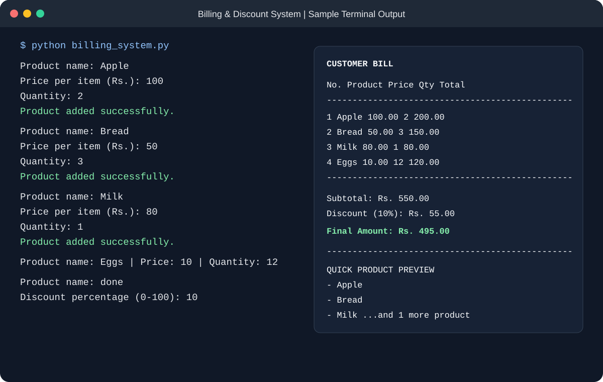

# Billing & Discount System

A beginner-level Python command-line project that collects product details, calculates a bill, applies a customer-entered discount, and prints a receipt.

## Features

- Add multiple products to a bill.
- Enter each product's unit price and quantity.
- Validate product names, prices, quantities, and discount percentages.
- Calculate each product total and the subtotal.
- Apply a discount from 0% to 100%.
- Display an itemized receipt and the final payable amount.
- Show a short preview of the first three products using list slicing.

## Python Concepts Used

- Variables and basic data types
- Lists and the `append()` method
- List indexing and slicing
- `while` and `for` loops
- `if` conditions, `break`, and `continue`
- Basic arithmetic operations
- String methods such as `strip()`, `lower()`, `replace()`, and `isdigit()`
- f-strings and formatted output

## Requirements

- Python 3
- No external libraries are required.

## How to Run

1. Download or clone this repository.
2. Open a terminal in the `Billing-and-Discount-System` folder.
3. Run:

```bash
python billing_system.py
```

On some systems, use `python3` instead of `python`.

## Example

The program asks for product details until you type `done`. It then asks for a discount percentage and displays an itemized receipt.

A sample terminal preview is available here:



## Learning Note

This is a learning project focused on practising Python fundamentals. It was prepared with AI assistance. Before presenting or extending it as your own work, make sure you can explain the code, test it yourself, and make your own improvements.

## Possible Future Improvements

- Add tax calculation.
- Add a customer name and bill number.
- Allow editing or removing a product before printing the bill.
- Save receipts to a text file.
